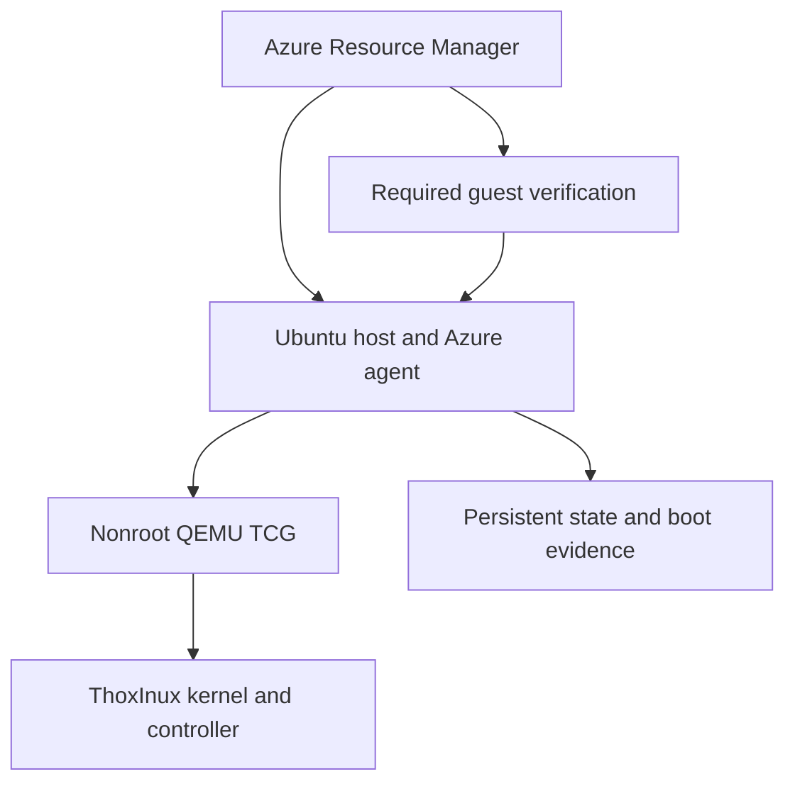

# ThoxOS on Azure

[](https://github.com/Thox-ai/thoxos-azure/actions/workflows/validate.yml)
[](https://github.com/Thox-ai/thoxos-azure/releases)
[](docs/RELEASE_NOTES.md)
[](https://github.com/Thox-ai/thoxinux/releases/tag/v0.9.1)
[](LICENSE)

Deploy the **ThoxInux v0.9.1 open source engineering release** on one Azure VM. This repository provisions the Azure host, boots the actual independent Rust kernel in QEMU, and verifies the running guest before the deployment can succeed.

**Your AI. Your Data. Your Rules.™**

<!-- deploy-button:start -->
[](https://portal.azure.com/#create/Microsoft.Template/uri/https%3A%2F%2Fraw.githubusercontent.com%2FThox-ai%2Fthoxos-azure%2Fv0.1.0%2Fazuredeploy.json)
<!-- deploy-button:end -->

The button loads this repository's versioned `v0.1.0/azuredeploy.json` through Microsoft's standard deployment form. It becomes usable once the source and tag are public. The [publication workflow](#publish-this-repository) checks that the anonymous raw URL returns the exact reviewed template bytes. See [publication status](docs/STATUS.md) for the latest recorded evidence and access requirements.

**Maturity: engineering preview.** Source validation is recorded in [validation evidence](docs/VALIDATION.json). Actual Azure provisioning and kernel acceptance must be verified in your subscription. This package runs ThoxInux inside an Ubuntu host; it does not qualify native ThoxInux boot on Azure Hyper-V or provide a complete graphical ThoxOS desktop.

The CI and deployment-release badges show their respective GitHub state, including prereleases. They do not certify an Azure VM or a kernel boot. The package, kernel and license badges identify this source package, its pinned component and its license.

## Who this is for

This environment is for OS developers, release engineers and contributors who need a repeatable Azure host for evaluating the open source kernel and controller. It combines infrastructure, verified artifact installation, persistent guest operation and boot evidence in one deployment. The [architecture guide](docs/ARCHITECTURE.md) explains the host, guest and network boundaries.

## Prerequisites

- An Azure subscription with permission to create compute/network resources and run commands on the VM.
- Regional quota for the selected Dsv5 size and a new dedicated resource group.
- An OpenSSH public key; the [user guide](docs/USER_GUIDE.md#before-deploying) includes key-generation instructions.
- For CLI deployment: authenticated Azure CLI, Python 3.10 or newer, Bash and `ssh-keygen` when generating a client key.

Review Azure charges before deployment. The portal workflow requires no local Azure CLI. Both workflows download public release assets and Ubuntu packages, so this is an online cloud environment.

## Deploy

1. Click **Deploy to Azure** and sign in to the intended Azure subscription.
2. Create a **new, dedicated resource group** and choose a region with Dsv5 quota/capacity. Keep the generated VM name or choose a new unused name.
3. Paste an existing OpenSSH **public** key. Keep the private key on your own client.
4. Review the VM size and Azure charges, then select **Review + create → Create**.
5. Wait for both the VM and its `verify-thoxinux-release` child resource to succeed. Open the deployment outputs for the VM resource ID and a fresh verification command.

The generic Azure form does not enforce an empty resource group. Use a new group; do not point this template at an existing workload. The separate CLI path includes explicit ownership and empty-group guards.

The button uses the Ubuntu marketplace's regional `latest` host image by default and reports the resolved image reference in its outputs. Supply an exact `imageVersion` to reproduce a particular host image. **The ThoxInux guest release and its file hashes remain pinned in every case.**

### What is created

| Component | Default |
| --- | --- |
| Azure host | Ubuntu Server 24.04 LTS x64, Generation 2 |
| VM size | `Standard_D2s_v5`: 2 vCPUs, 8 GiB RAM |
| Larger option | `Standard_D4s_v5`: 4 vCPUs, 16 GiB RAM |
| Host storage | 128 GiB persistent Standard SSD |
| Host security | Trusted Launch, Secure Boot, vTPM; password login disabled |
| Actual guest | ThoxInux v0.9.1, QEMU TCG, 1 vCPU, 2 GiB RAM |
| Guest persistence | Nonroot systemd service and persistent sparse guest volume |
| Network | VNet, subnet, NIC, Standard static public IP for explicit outbound connectivity |
| Inbound access | NSG denies all inbound traffic; no SSH/RDP/VNC/web console is opened |
| Administration | Azure Run Command through the host VM agent |
| Acceptance | Required managed Run Command validates the current guest boot |

The managed OS disk is created with the VM. The template declares six top-level resources, including the required verification child resource. There is no GPU, NAT gateway, Bastion, or paid monitoring workspace. The VM does **not** automatically shut down. Compute, managed disk, Standard public IPv4 and applicable transfer charges apply. Deallocating the VM stops compute billing; disk and public-IP charges remain. Review current [Azure pricing](https://azure.microsoft.com/en-us/pricing/calculator/) for your account and region.

### Architecture preview



This is an implementation diagram, not a screenshot or a record of a completed cloud deployment. The [full architecture](docs/ARCHITECTURE.md) describes outbound traffic, artifact verification and the separate host/guest boot-trust settings.

## Use the real guest

In the VM's Azure **Run command → RunShellScript** surface, run:

```bash
/usr/local/sbin/thoxos-release-status
/usr/local/sbin/thoxinux-console status
/usr/local/sbin/thoxinux-console components
/usr/local/sbin/thoxinux-console 'domain list'
```

Guest console and QMP sockets remain local to the host. Controller commands execute inside the real guest. The read-only status command does not inject commands or start a guest.

The managed deployment check waits for cloud-init and verifies the actual EFI hash, release identity, active service, live QMP state, kernel/controller serial markers, absence of panic markers, and four controller checks from the **current boot**. Each subsequent service or host restart produces new boot evidence. If this gate fails, Azure resources may already exist and remain billable; inspect the preserved logs before retrying.

### Stop, resume and recover

Use the actual resource names from your deployment outputs:

```bash
az vm deallocate --subscription YOUR_SUBSCRIPTION_UUID \
  --resource-group YOUR_RESOURCE_GROUP --name YOUR_VM_NAME

az vm start --subscription YOUR_SUBSCRIPTION_UUID \
  --resource-group YOUR_RESOURCE_GROUP --name YOUR_VM_NAME
```

Deallocation preserves the disk and stops VM compute billing; storage and the static public IP remain chargeable. After restarting, collect fresh guest status. For failed bootstrap or verification, use the [troubleshooting guide](docs/USER_GUIDE.md#troubleshooting-and-recovery) before changing or deleting resources. There is no automatic backup or destructive cleanup routine.

## CLI alternative

Use an authenticated Azure CLI and an explicit intended subscription:

```bash
python3 deploy.py deploy --subscription YOUR_SUBSCRIPTION_UUID
```

This path resolves an exact Ubuntu image version, checks the SKU, prepares a plan, runs Azure validation and what-if, provisions a new dedicated resource group/VM, and collects actual guest status. The default CLI region is `centralus`, VM `thoxos-open-v091`, resource group `rg-thoxos-open-release-v091`. These names differ from the portal's generated unique VM name.

To prepare without provisioning:

```bash
python3 deploy.py prepare --subscription YOUR_SUBSCRIPTION_UUID --out plan-review
```

To verify an existing deployment, use its actual names:

```bash
python3 deploy.py status \
  --subscription YOUR_SUBSCRIPTION_UUID \
  --resource-group YOUR_RESOURCE_GROUP \
  --vm-name YOUR_VM_NAME \
  --out thoxos-azure-status
```

## Release and source provenance

Deployment-package version **v0.1.0** is separate from kernel-release version **v0.9.1**.

| Item | Pinned value |
| --- | --- |
| Kernel release | [Thox-ai/thoxinux v0.9.1](https://github.com/Thox-ai/thoxinux/releases/tag/v0.9.1) |
| Kernel/launcher source | `84b4a7e740496297ca79dff735834ca2a8f2bad3` |
| EFI SHA-256 | `1bc1c7af33470edc009fa5756d3fe6063573660e07e157d19397afc680a7bb89` |
| Release build receipt | `5b6f2eb2aff311db9924d7d3f6da4d2802b6f04b01d72d73a3f5784340df384c` |

The reviewed bootstrap is embedded directly in the ARM template. At provisioning, it downloads and verifies the published EFI, receipt, complete checksum inventory, license, notice and pinned launcher. It does not execute a moving-branch bootstrap or use the stale Azure-candidate receipt in the canonical repository's older files.

The kernel's prior 22-command lifecycle evidence was inherited from v0.9.0; v0.9.1 was not separately lifecycle-run in that release wave. This repository requires fresh current-boot checks and makes no full Linux workload or graphical application acceptance claim.

## Documentation

- [Documentation index](docs/README.md)
- [User guide: setup, commands, stop/start and troubleshooting](docs/USER_GUIDE.md)
- [Architecture and trust boundaries](docs/ARCHITECTURE.md)
- [Development, testing, publication and release process](docs/DEVELOPMENT.md)
- [Preparation status and remaining live checks](docs/STATUS.md)
- [Validation evidence](docs/VALIDATION.json)
- [Release notes](docs/RELEASE_NOTES.md)
- [Security guidance](SECURITY.md) and [contributing](CONTRIBUTING.md)

## Support and contribution

Use [GitHub issues](https://github.com/Thox-ai/thoxos-azure/issues) for reproducible deployment problems and documentation corrections. Include the deployment-package version, kernel version, region, stage that failed, and sanitized diagnostic output. Keep private keys, access tokens and sensitive workload logs out of public reports.

For security findings, follow [SECURITY.md](SECURITY.md). For source changes, follow [CONTRIBUTING.md](CONTRIBUTING.md) and run `python3 scripts/validate.py`. Reviews must preserve the distinction between offline source checks, Azure provisioning and actual guest acceptance. This preview has no production-support SLA.

## Publish this repository

The public repository [Thox-ai/thoxos-azure](https://github.com/Thox-ai/thoxos-azure) exists. An authorized maintainer can publish the reviewed source to `main` or merge a reviewed change into `main`. The included [GitHub Actions workflow](.github/workflows/validate.yml) then:

1. Runs the offline source-validation job with read-only repository permissions.
2. For a successful push to this canonical repository's `main`, starts the release job at that exact commit using a repository-scoped token with content-write permission.
3. Builds the allowlisted source archive, creates the configured version tag and engineering prerelease, and verifies the public template and downloaded release-asset bytes.
4. Records the source commit, release URL, template digest, asset hashes and outcome in `release-publication-receipt.json`, preserved with the workflow's publication artifact for 30 days.

Pull requests and manual workflow dispatch run validation only. No Azure resources are created by this workflow. Existing tags and release assets are never overwritten. **After a version has been issued, every new commit published to `main`, including a documentation change, requires a new `deploymentVersion` and matching release documentation/button.** A version that already names a different commit causes publication to fail explicitly. See the [development guide](docs/DEVELOPMENT.md#automatic-release-from-main) for release and recovery details.

Repository visibility and a user's role do not establish that a particular integration can write files or workflows. Publication requires actual repository content/workflow access and an enabled Actions release job. The [status record](docs/STATUS.md) describes the current access gap without implying that a release or cloud deployment has completed.

### Initial publication helper

For a fresh source snapshot and an empty or exactly matching public repository, the CLI helper remains available:

```bash
gh auth login
python3 scripts/publish.py --public --repository Thox-ai/thoxos-azure
```

The helper validates the source, pushes only allowlisted files, waits for the exact commit's workflow, and verifies the version tag, public template and release assets. It can create a missing public repository when the authenticated identity has that permission. Existing unrelated history, private visibility, mismatched origins and tags pointing elsewhere are refused. It resumes only an exact matching initial snapshot; use the normal reviewed `main` workflow for later changes.

Use an identity authorized to write this repository and its workflow files; repository-creation permission is needed only when creating a missing target. No credentials are stored in the source. Inspect any permission error or partial publication before retrying.

### Download and verify a release

After `v0.1.0` appears as a published [GitHub Release](https://github.com/Thox-ai/thoxos-azure/releases), run these commands from a new download directory with GitHub CLI, Python and `sha256sum` available:

```bash
gh release download v0.1.0 --repo Thox-ai/thoxos-azure \
  --pattern 'thoxos-azure-v0.1.0.zip' \
  --pattern 'thoxos-azure-v0.1.0.sha256'
sha256sum --check thoxos-azure-v0.1.0.sha256
python3 -m zipfile -e thoxos-azure-v0.1.0.zip .
cd thoxos-azure-v0.1.0
sha256sum --check SHA256SUMS
```

Both checksum checks must succeed before using the extracted files. On macOS, use `shasum -a 256 --check` in place of `sha256sum --check`. Match the release's source commit to its successful workflow and publication receipt; a checksum result alone does not establish Azure acceptance.

## License and ownership

Copyright 2026 THOX.ai LLC. Deployment automation is licensed under [Apache-2.0](LICENSE). See [NOTICE](NOTICE) for upstream attribution and separate component licensing.

This repository contains the open source deployment integration. Proprietary MeshStack and ThoxWork application code and ThoxKey firmware are not included.
