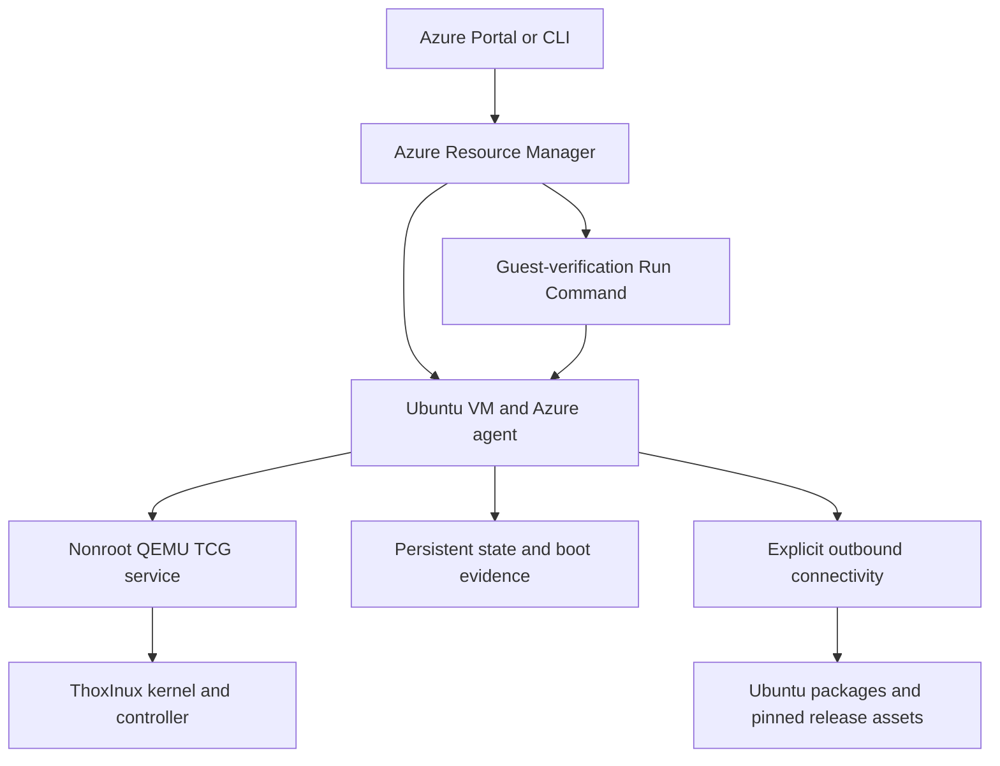

# Architecture

The deployment package **0.1.0** runs the **ThoxInux v0.9.1** independent Rust kernel as a QEMU TCG guest on an Azure Ubuntu host. The host supplies the Azure-compatible storage, networking, provisioning and management agent. This follows the canonical project's [Azure architecture](https://github.com/Thox-ai/thoxinux/blob/fbad5952f20281ef6ad7eaefc1f54f7db4c0c6e9/docs/deployment-azure/README.md); it does not establish native ThoxInux Hyper-V compatibility.

## Deployment and runtime

This diagram describes the implementation. It is not a capture of a deployed system.

| Component | Responsibility |
| --- | --- |
| Standalone ARM template | VM, network, Standard public IPv4, security group, persistent OS disk and mandatory managed verification command |
| Ubuntu 24.04 Gen2 host | Azure drivers/agent, cloud-init, package installation, systemd and operational tools |
| `guest-bootstrap.sh` | Fetch and verify pinned release files; install the isolated guest service and local administration helpers |
| `thoxinux.service` | Run the supervisor and QEMU as the locked `thoxinux` account; start with the host and recover bounded failures |
| Guest supervisor | Retain boot-specific serial output, check the controller prompt, run four read-only commands per boot and expose a local command socket |
| `thoxos-release-status` | Read-only validation of release identity, artifact integrity and current runtime evidence |
| `deploy.py` | Subscription-explicit CLI preparation, ownership checks, ARM validation/what-if and evidence collection |

## Trust and version boundaries

The default host is `Standard_D2s_v5`, 2 vCPUs and 8 GiB RAM, with a 128 GiB Standard SSD. `Standard_D4s_v5` is an optional larger host. The guest retains the canonical launcher's tested **one vCPU and 2 GiB RAM**. A larger Azure VM does not automatically increase the guest's memory or establish new kernel compatibility.

The Azure host uses Trusted Launch with Secure Boot and vTPM. The independent guest uses OVMF with guest Secure Boot disabled because the released EFI is not signed for that path. TCG emulates the guest CPU, so this configuration makes no KVM acceleration or nested-virtualization claim.

The kernel release is pinned to source commit `84b4a7e740496297ca79dff735834ca2a8f2bad3` and EFI SHA-256 `1bc1c7af33470edc009fa5756d3fe6063573660e07e157d19397afc680a7bb89`. The bootstrap also verifies the released receipt/checksum inventory and the matching license, notice and unchanged launcher. The [release](https://github.com/Thox-ai/thoxinux/releases/tag/v0.9.1) remains an engineering preview.

Host-image selection differs by entry point. The portal can resolve the current Ubuntu 24.04 marketplace image from `latest`; record Azure's returned `exactVersion` afterward. The CLI resolves and records an explicit image version before deployment. Installed Ubuntu packages can change over time. Exact kernel pins do not make the entire host a reproducible image.

## Network and administration

The NIC has a Standard static public IPv4 address for explicit outbound traffic. Its NSG denies all inbound connections, including the default virtual-network allowance. No SSH, RDP, VNC, QMP or application endpoint is published. Azure Run Command uses the host agent for administration.

The guest command socket and QMP socket exist only under `/run/thoxinux` as UNIX sockets. The supervisor is nonroot, with systemd filesystem restrictions and a locked service account. The canonical launcher exposes no host directory shares or physical-device passthrough. Its user-mode guest network permits outbound traffic through the host; this environment is not offline.

The deployment supplies no storage credentials, GitHub token, SSH private key, managed-identity role assignment or application secret to the guest. Public artifacts are fetched over HTTPS and checked against fixed digests. Restrict Azure control-plane permissions because an operator authorized to run host commands has privileged host access.

## State and evidence

The host disk persists across stop/deallocate/start. Guest state is stored under `/var/lib/thoxinux`; the canonical guest volume is a 64 GiB sparse file. Payloads reside under `/opt/thoxinux/releases/v0.9.1`. Serial logs, current boot metadata and smoke receipts reside under `/var/log/thoxinux`. Runtime sockets are recreated on each service start. No automatic backup is included.

Each supervisor boot gets a new boot identity. It must reach the expected controller prompt, then produce successful responses to `status`, `components`, `domain list` and `help`. Status checks reject missing or mismatched current-boot evidence and do not inject new commands.

The managed verification resource waits for cloud-init and tests this actual runtime. Its failure can leave successfully created, billable Azure resources behind. Do not infer acceptance from a running VM, an earlier boot receipt, an offline test, or the existence of the template.

## Supported scope

This project provides a cloud test environment for the released kernel/controller. It does not qualify a graphical desktop, arbitrary Linux applications, native Azure kernel boot, physical device installation, model inference performance, or the proprietary MeshStack/ThoxWork platforms. Read the [user guide](USER_GUIDE.md) for operation and recovery and the [README](../README.md) for current validation and publication state.
